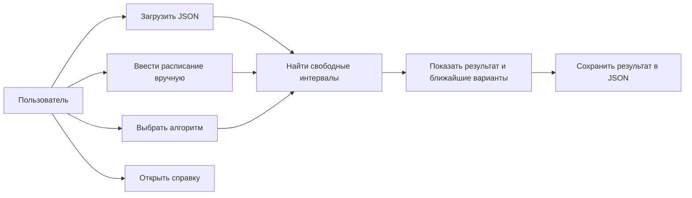

# МТПО Практическая работа 1

## Текущий этап

Подготовлены модульные тесты дипломного модуля, два автономных алгоритма подбора времени и протокол нового цикла TDD. Консольное приложение запускается командой `npm start`. Текущий общий запуск содержит 226 успешных тестов. Это промежуточный результат лабораторной, не полный комплект для сдачи. Исходный дипломный репозиторий не изменён.

## Запуск

Требуется Node.js версии 24 или новее. Установка сторонних пакетов не нужна. Node выполняет используемый поднабор TypeScript самостоятельно; отдельная проверка типов этим запуском не производится.

Из текущей папки:

```sh
npm test
npm run test:coverage
```

Без npm:

```sh
node scripts/run-tests.mjs --coverage
```

Результаты записываются в `reports/test-run.txt` и `reports/results.json`. При каждом запуске файлы заменяются актуальными результатами. JSON содержит названия тестов, исходы и полученные метрики покрытия. Покрытие собирается встроенным механизмом Node.js/V8; это покрытие строк, ветвей и функций выбранного файла, а не метрика всего приложения или отдельный подсчёт операторов по AST.

## Происхождение кода

`src/booking.ts` — зафиксированная копия `server/src/booking.ts` дипломного проекта. Изменён только путь импорта базы `./db` → `./db.ts` для автономного запуска. Тела функций не менялись. Хеши и описание адаптации сохранены в `source-manifest.json`.

`src/db.ts` не создаёт соединений с PostgreSQL. Без явно переданной или подменённой зависимости обращение к базе завершится ошибкой. Тесты не читают `.env`, не изменяют рабочую базу и не отправляют письма.

## Состав проверок

- `tests/schedule.test.mjs`: классы эквивалентности (EQ), граничные значения (BV), пути выполнения операторов (ST), исходы условий (BR), устойчивость к неподходящим типам.
- `tests/availability.test.mjs`: отсутствие часов работы, пустой цикл, прошедшие начала, пересечения, получасовые промежутки, примыкания, готовые конфликты соседних объектов и технические блокировки; передача SQL-параметров, ключи блокировок, распространение ошибок.
- Текущее время фиксируется: 24.11.2026 12:00 по Москве. Для отдельного секундного теста задано 11:59:59.
- В тестах применяются параметризованные наборы, поддельные ответы базы, наблюдение за вызовами, подмена метода пула и часов.
- Используются `equal`, `deepEqual`, `match`, `ok`, `doesNotThrow`, `rejects` из `node:assert/strict`.

Часть сценариев повторена в наборах разных техник для прослеживаемости учебных таблиц. Число запущенных тестов не равно числу уникальных входных комбинаций. Оптимизация и сравнение наборов — следующий отдельный этап.

## Границы доказательности

Подмена базы возвращает заранее заданные строки. Тесты проверяют использование этих строк алгоритмом и передачу параметров, но не выполняют SQL. В частности, фильтрация отменённых записей и вычисление несовместимости видов спорта внутри SQL требуют интеграционных тестов PostgreSQL. Проверка порядка вызовов блокировок не подтверждает отсутствие конфликтов при реальном параллельном исполнении.

`scheduleError` проверяет дату и длительность; `availableSlots` рассчитывает интервалы для подготовленных параметров. Эти функции не проверяют срок отмены и переноса 48 часов. Тесты этого правила потребуют отдельного модуля/маршрута.

## Что остаётся для полной лабораторной

1. Оптимизация и сравнительная таблица наборов четырёх техник.
2. Два сравниваемых алгоритма и протокол TDD — выполнено на этапе 3.
3. Консольный ввод, JSON-примеры и рекомендации — выполнено на этапе 4.
4. Предусловия, матчеры и тестовые двойники — проверены на этапе 6.
5. Мутационное тестирование и анализ результатов — выполнено на этапе 5.
6. Итоговый отчёт и архив кода подготовлены отдельно.

Покрытие 100% само по себе не доказывает отсутствие ошибок и не заменяет мутационную оценку.

## Документация инструмента

[Официальная документация Node.js Test runner](https://nodejs.org/docs/latest-v24.x/api/test.html).

## Этап 2 Оптимизация и сравнение

```sh
npm run test:compare
```

Команда отдельно запускает набор каждой из четырёх техник и полные исходный/объединённый наборы. Данные таблиц берутся из результатов запуска, а не заполняются вручную. Общие 15 контрольных точек заданы в `test-data/coverage-items.mjs`, исходные 48 примеров — в `test-data/schedule-cases.mjs`. Типобезопасное объединение находится в `test-data/merge-cases.mjs`.

Получено 31 уникальное сочетание даты и длительности вместо 48 повторяющихся примеров. Сохранены все 48 исходных ID и ожидаемые результаты. На сопоставимом наборе всего модуля число тестов уменьшилось с 85 до 68. Обычный `npm test` дополнительно выполняет три проверки алгоритма объединения: итог 71 тест.

Результаты:

- `reports/comparison.csv` — сравнительная таблица;
- `reports/comparison.json` — метрики и границы их интерпретации;
- `reports/traceability.json` — связь объединённых примеров с исходными ID;
- `reports/comparison/*/` — отдельные протоколы каждого запуска;
- `report/02_Проектирование_тестов.docx` — подготовленный раздел будущего отчёта.

При сравнении V8 выдал разные знаменатели количества ветвей в отдельных запусках. Поэтому для прямого сравнения использованы фиксированные 15 контрольных точек и шесть исходов трёх внешних `if`, а проценты V8 сохранены только как диагностические данные. Человеко-часы проектирования не измерялись; оценка трудоёмкости в разделе отчёта является качественной.

Этим этапом завершено сравнение техник проектирования тестов. Реализация алгоритмов и консольного меню описана ниже.

## Этап 3 Два алгоритма и зафиксированный TDD

Создан автономный модуль `src/slot-search.mjs` с двумя публичными функциями:

- `findAvailableScan` перебирает начала игры и проверяет списки интервалов;
- `findAvailableMasks` строит 48-битовые BigInt-маски занятости и проверяет пересечение побитовым И.

Универсальные залы представлены одним физическим ID, виды спорта — массивом `sports`. Рёбра `adjacency` связывают два объекта; `allowedPairs` задаёт пары видов спорта в порядке `courtA`, `courtB`. Связь читается с обеих сторон. Техническая блокировка закрывает только свой объект. Для запрета получасового разрыва в масочном алгоритме используется отдельное множество начал: маски не расширяются, поэтому примыкание остаётся разрешённым.

Требуются все поля JSON, показанные в `examples/input`. Время `now` обязательно содержит часовой пояс. Результат — массив `{courtId,start,end}` в числовом порядке площадок и хронологическом порядке начал. Случаи с некорректной структурой данных отклоняются `TypeError`. При закрытом дне или отсутствии подходящих объектов возвращается пустой массив. Входные данные не изменяются.

### Реальный цикл TDD

В `reports/tdd/01-schedule` сохранены протоколы и снимки исходника:

1. `red`: обе функции ещё выбрасывают ошибку отсутствия реализации; 102 теста не проходят.
2. `green`: реализованы оба алгоритма; те же 102 теста проходят.
3. `refactor`: маска длительности вынесена из цикла; те же 102 теста проходят.

Хеши тестов и исходных наборов одинаковы во всех трёх фазах, хеши исходника различаются. Протоколы существующих фаз не перезаписываются. Дополнительные проверки повреждённых дат хранимых записей добавлены позднее в отдельный файл `search-validation.test.mjs`; они не выдаются за часть первоначального цикла.

### Запуск и результаты

```sh
npm run test:algorithms
npm run compare:algorithms
npm run test:coverage
```

- `reports/algorithms-comparison.json` — сравнение на 200 воспроизводимых расписаниях и синтетический замер времени;
- `reports/algorithms-comparison.csv` — таблица времени;
- четыре входных JSON в `examples/input`, соответствующие результаты в `examples/output`;
- отдельный тест сверяет оба алгоритма с модулем диплома на 30 расписаниях при подменённых SQL-ответах.

Совпадение алгоритмов — дополнительная проверка. Оно дополняется примерами с заранее заданными ответами; общая валидация является общей зависимостью и не проверяется одним сравнением двух функций. Замеры времени включают валидацию и построение индексов. Это локальный эксперимент в памяти, не нагрузочный тест сайта, PostgreSQL или почты.

Интерактивное меню добавлено на этапе 4 ниже. Раздел об инструментах и итоговый отчёт остаются в работе.

Описание псевдокода, форматов, фаз TDD и измерений подготовлено в `report/04_Алгоритмы_и_TDD.docx`.

## Этап 4 Консольное приложение

Запустите `npm start` из папки лабораторной. Нужен Node.js 24 или новее.

| Пункт | Действие |
|---|---|
| 1 | Загрузить расписание по пути к JSON |
| 2 | Ввести дату, вид спорта, длительность, часы работы и площадки вручную. При необходимости добавить массивы броней, блокировок и смежности |
| 3 | Выбрать прямую проверку, битовые маски или оба алгоритма. По умолчанию запускаются оба |
| 4 | Выполнить поиск и вывести результат |
| 5 | Сохранить результат в новый JSON |
| 6 | Открыть справку |
| 0 | Завершить работу |

Для демонстрации загрузите `examples/input/05-preferred-time.json` через пункт 1 и нажмите 4. В расписании занято 08:00, поэтому программа предложит 09:00. Момент отсчёта задан в JSON и выводится при загрузке. При ручном вводе Enter в поле времени отсчёта использует системное время.

Желаемое начало задаётся вручную или полем `preferredStart` в JSON (формат ЧЧ:ММ с шагом 30 минут). Если оно свободно, программа покажет все подходящие площадки на это время. Иначе предложит до трёх ближайших начал на той же дате, со всеми доступными площадками на каждое начало. При одинаковом отклонении сначала идёт более раннее начало. Если желаемое начало не указано, программа выводит все доступные интервалы дня.

Пункт 5 записывает результат последнего поиска. В файле `slots` содержит все доступные интервалы, `matches` — совпадения с желаемым началом (или все интервалы без него), `alternatives` — ближайшие варианты с отклонением в минутах. `algorithmsAgree` равно true при успешной сверке и null при запуске одного алгоритма. Пример сохранения через меню расположен в `examples/output/05-preferred-time.json`.

Успешная загрузка или смена алгоритма сбрасывает предыдущий результат. Ошибка чтения позволяет вернуться к меню, а сохранение по существующему пути предлагает выбрать новое имя. Формат входа не задаёт фиксированного лимита числа записей. JSON читается целиком, поэтому практический предел определяется доступной памятью и ограничениями Node.js.

Команда `npm run test:console` проверяет рекомендации, чтение и запись файлов, восстановление после ошибки и работу реального меню. Общий набор запускается через `npm run test:coverage`. Метрики покрытия в этой команде по-прежнему относятся к двум файлам алгоритмов.



## Этап 5 Мутационное тестирование

На файле `src/slot-search.mjs` выполнены два прогона StrykerJS 10.1.1. В первом 108 тестовых примеров. Во втором 146, из них 38 добавлены после анализа первого прогона. Общий набор лабораторной содержит 226 пройденных тестов.

| Показатель | До | После |
|---|---:|---:|
| Сгенерировано мутаций | 429 | 429 |
| Убито проверками | 333 | 404 |
| Выжило | 92 | 21 |
| Превышено время | 4 | 4 |
| MSI, доля убитых | 77,62 % | 94,17 % |
| LCC, покрытие строк | 100 % | 100 % |
| MCC по строкам | 100 % | 100 % |
| CoveredCodeMSI по строкам | 77,62 % | 94,17 % |

MSI считает только статус Killed. Stryker учитывает Timeout в своей метрике Mutation score. Для MCC и CoveredCodeMSI использованы строки начала мутаций и отдельные замеры покрытия Node/V8 для каждого набора. Эти показатели отражают покрытие строк, содержащих мутации. Командный режим StrykerJS запускает весь выбранный набор на мутацию и не даёт прямого измерения исполнения каждого изменённого выражения. [Документация командного режима StrykerJS](https://stryker-mutator.io/docs/stryker-js/configuration/).

В первом прогоне выжило удаление проверки даты у технических блокировок. Новый тест блокирует первые 30 минут выбранной даты и добавляет блокировку на другой день. Результат должен содержать 08:30 и 09:00. Аналогично добавлен тест допустимого начала в 00:00 будущего дня, который выявляет замену `-1` на `+1`. Всего новые проверки убили 71 ранее выжившую мутацию.

Пример эквивалентной мутации №240 удаляет `.slice()` после `.filter()`. Фильтрация уже создаёт новый массив, и последующая сортировка получает те же элементы. Выжившие мутации не исключаются из основного MSI. Мутационная адекватность для всего набора не подтверждена.

Для сценария `scan: TOUCH-BEFORE` предложенная игра заканчивается точно в момент начала существующей. Замена `end > row.startMinute` на `end >= row.startMinute` ошибочно запрещает примыкание, и тест падает. На строке функции пересечения этим тестом обнаружены 5 из 10 мутаций. Все десять отдельных замен и исходы записаны в `reports/mutation/overlap-single-test.json`.

```sh
npm ci
MTPO_MUTATION_BASELINE=1 npm run test:mutation
npm run test:mutation
node scripts/probe-overlap-mutations.mjs
npm run test:coverage
```

HTML-отчёты находятся в `reports/mutation/before.html` и `reports/mutation/index.html`. Команда `npm run test:mutation:summary` строит JSON-сводку из сохранённых прогонов и протоколов покрытия. Сводка `reports/mutation/summary.json` содержит результаты по каждому оператору мутации и перечень 71 дополнительно убитой мутации. Протоколы V8 для расчёта LCC и построчного MCC находятся в `reports/mutation/coverage-before` и `reports/mutation/coverage-after`.

## Этап 6 Предусловия и тестовые двойники

В `tests/test-techniques.test.mjs` есть два предусловия. Первое проверяет доступность часового пояса Europe/Moscow. Второе пропускает сценарий вывода справки, если задан флаг `MTPO_SKIP_CONSOLE_STREAM=1`. Сценарий проверяет реальные вызовы записи с помощью spy. Stub отдаёт готовые строки расписания в `tests/algorithms.test.mjs`, а mock в `tests/availability.test.mjs` позволяет проверить аргументы и число SQL-вызовов.

`assert.match` сопоставляет строку с регулярным выражением. Объектный матчер `{code: 'EEXIST'}` в `tests/console.test.mjs` проверяет код ошибки записи. В наборе используются `equal`, `deepEqual`, `ok`, `doesNotThrow` и `rejects`.

Для обычного запуска тестов достаточно Node.js 24 или новее. Для воспроизведения мутационного анализа сначала установите StrykerJS из lock-файла командой `npm ci`. Папка зависимостей в архив не входит. Репозиторий дипломного проекта: https://github.com/viko4ka73/online-booking.
